<p align="center">
  
</p>

<p align="center">
  <a href="https://github.com/ishandutta2007/Awesome-Business-Messaging-Whatsapp-Marketing"></a>
  <a href="https://github.com/ishandutta2007/Awesome-Business-Messaging-Whatsapp-Marketing/network/members"></a>
  <a href="https://github.com/sindresorhus/awesome"></a>
  <a href="https://github.com/ishandutta2007/Awesome-Business-Messaging-Whatsapp-Marketing/blob/main/LICENSE"></a>
  
</p>

# Awesome Business Messaging & WhatsApp Marketing

> **A curated directory of enterprise SaaS platforms, Meta Business Solution Providers (BSPs), and open-source self-hosted WhatsApp gateways, omnichannel shared inboxes, and conversational marketing automation frameworks.**

Whether you are building high-volume automated notification pipelines, conversational AI agents, omnichannel customer support workflows, or click-to-WhatsApp promotional campaigns, choosing the right stack requires navigating official Meta Cloud API compliance, per-template billing, and self-hosted open-source bridges.

---

## Table of Contents

- [Sector Overview & Market Dynamics](#sector-overview--market-dynamics)
- [SaaS / Hosted Platforms](#saas--hosted-platforms)
  - [SaaS Products Comparison](#saas-products-comparison)
  - [Detailed SaaS Profiles](#detailed-saas-profiles)
- [Open-Source GitHub Projects](#open-source-github-projects)
  - [Open-Source Projects Overview](#open-source-projects-overview)
  - [Detailed Open-Source Profiles](#detailed-open-source-profiles)
- [Architecture & Tech Stack Combinations](#architecture--tech-stack-combinations)
- [Contributing](#contributing)
- [Disclaimer & Compliance](#disclaimer--compliance)

---

## Sector Overview & Market Dynamics

The global conversational messaging market is currently valued at approximately **$14.5 billion** (with the dedicated WhatsApp business messaging segment exceeding **$3.8 billion**), expanding rapidly at an estimated **18% to 22% CAGR** as enterprises shift customer engagement from email and SMS toward chat apps.

The sector exhibits **moderate fragmentation with tiered concentration**: enterprise infrastructure layer (CPaaS) is concentrated among major telecom-integrated players like Twilio and Infobip, while the business application and conversational commerce layers remain highly fragmented across hundreds of regional BSPs and specialized vertical tools competing on CRM depth, localized support, and pricing models rather than a winner-take-all monopoly.

---

## SaaS / Hosted Platforms

### SaaS Products Comparison

The following table compares category-leading SaaS platforms and official Meta Business Solution Providers (BSPs), sorted in descending order by **Company Size (Revenue / Market Capitalization / Valuation)**.

| SaaS Product | Company Size (Revenue / Valuation) | Pricing (Starting Tier) | Free Tier Limits / Free Trial Details | Core Focus & Deployment |
| :--- | :--- | :--- | :--- | :--- |
| **[Twilio](https://www.twilio.com/)** | **~$40B Market Cap** (~$5.1B ARR) | **$0.005 / message** + Meta template rates (Pay-as-you-go, no base fee) | **Free sandbox trial** with ~$15 in trial credits; no permanent free production tier | Enterprise CPaaS, developer APIs, omnichannel communications |
| **[HubSpot](https://www.hubspot.com/)** | **~$12B Market Cap** (~$3.1B ARR) | **$90/seat/mo** (Service Hub Pro) or **$800/mo** (Marketing Hub Pro) + Meta fees | **14-day free trial** of Professional Hubs; native WhatsApp connection is locked out of Free/Starter tiers | CRM, inbound marketing, customer service automation |
| **[Infobip](https://www.infobip.com/)** | **~$2B Revenue** (~$1.1B Valuation) | **Pay-as-you-go** consumption; platform suites (AgentOS) start at **$530/mo** | **60-day self-signup trial** with ~100 test messages restricted to verified developer numbers | Global enterprise omnichannel carrier network & orchestration |
| **[Bird (MessageBird)](https://bird.com/)** | **~$1B Valuation** (~€475M Revenue) | **$15/mo** wallet minimum deposit (Startup) or **$0/mo** pay-as-you-go platform fee | **$0 platform fee tier** with free API sandbox testing; production messages require wallet funding | Omnichannel automation, marketing flows, CRM integrations |
| **[Brevo](https://www.brevo.com/)** | **~$1B Valuation** (~€200M ARR) | **$499/mo** (Professional tier required for WhatsApp campaigns) + credit packs | **Free plan: 300 emails/day** for up to 100k contacts; bulk WhatsApp campaigns completely locked on Free/Starter | Integrated email, SMS, and WhatsApp marketing platform |
| **[Gupshup](https://www.gupshup.io/)** | **~$300M Valuation** (~$360M Revenue) | **$0.001 / message** platform fee + Meta fees (Pay-as-you-go self-serve) | **Free testing credits** on sandbox signup; 1,000 free Meta service messages/mo per number | Enterprise conversational AI, automated chatbots, bot studio |
| **[Respond.io](https://respond.io/)** | **~$250M Valuation** (~$25M ARR) | **$79/mo** billed annually ($99/mo monthly) for up to 1,000 monthly active contacts | **7-day free trial** with full feature access and sandbox testing; no permanent free plan | Omnichannel inbox, AI support agent, zero BSP message markup |
| **[Trengo](https://trengo.com/)** | **~$150M Valuation** (~$15M ARR) | **€299/mo** billed annually (covers up to 5 users and omnichannel channels) | **14-day free trial** with access to core shared inbox features; no permanent free plan | Shared team inbox, multi-channel customer service management |
| **[Wati](https://www.wati.io/)** | **~$92M Valuation** (~$17.5M ARR) | **$59/mo** (Growth plan billed annually, 5 users) + ~20% Meta fee markup | **7-day free trial** with 50 test credits; no permanent free plan | WhatsApp-first CRM, broadcast campaigns, no-code bot builder |

---

### Detailed SaaS Profiles

#### 1. Twilio
- **Website**: [twilio.com](https://www.twilio.com/)
- **Pricing**: Pay-as-you-go starting at **$0.005 per message** (sent or received via Programmable Messaging API) plus regional Meta template fees. Volume discounts available.
- **Free Tier / Trial**: Provides a free sandbox testing environment with **~$15 in initial test credits**. Only sends to pre-registered verification numbers until upgraded.
- **Best For**: Engineering teams and product builders requiring rock-solid API reliability, multi-channel fallbacks (SMS/voice), and programmatic routing.

#### 2. HubSpot WhatsApp Integration
- **Website**: [hubspot.com](https://www.hubspot.com/)
- **Pricing**: Native WhatsApp integration requires **Marketing Hub Professional (starts at ~$800/mo)** or **Service Hub Professional (starts at ~$90/user/mo)**. Includes a pool of 1,000 template messages/month; add-on packs cost ~$70/mo per 1,000 messages.
- **Free Tier / Trial**: 14-day free trial for Professional packages. Native WhatsApp is **not available on HubSpot Free or Starter** tiers (third-party marketplace connectors like MakeWebBetter must be used for lower-tier accounts).
- **Best For**: Mid-market and enterprise sales/marketing teams centered around HubSpot CRM wanting inbound messaging logged natively on contact timelines.

#### 3. Infobip
- **Website**: [infobip.com](https://www.infobip.com/)
- **Pricing**: Pay-as-you-go per message/channel unit; conversational management and AI agent platforms (AgentOS) start at **$530/mo**.
- **Free Tier / Trial**: Offers a **60-day self-service evaluation trial** loaded with test credits covering ~100 messages to verified developer numbers.
- **Best For**: Multinational enterprises seeking telecom-grade SLAs, direct carrier connectivity across hundreds of global markets, and strict regulatory compliance.

#### 4. Bird (formerly MessageBird)
- **Website**: [bird.com](https://bird.com/)
- **Pricing**: Flexible pay-as-you-go with $0 software license fee, or funded deposit tiers starting at **$15/month** (Startup) or **$100/month** (Growth) which reduce outbound processing fees.
- **Free Tier / Trial**: Pay-as-you-go model allows free account creation with sandbox testing before adding balance.
- **Best For**: Omnichannel growth teams orchestrating automated conversational flows across WhatsApp, SMS, and Email.

#### 5. Brevo
- **Website**: [brevo.com](https://www.brevo.com/)
- **Pricing**: WhatsApp campaigns and automated workflows require the **Professional plan starting at $499/month** plus pay-as-you-go prepaid WhatsApp credit bundles.
- **Free Tier / Trial**: Standard Brevo account offers a free-forever tier (limited to 300 emails/day, 100k contacts), but WhatsApp broadcasting is **disabled on Free and Starter plans**.
- **Best For**: E-commerce marketers looking to synchronize multi-channel newsletter blasts with WhatsApp promotional broadcasts.

#### 6. Gupshup
- **Website**: [gupshup.io](https://www.gupshup.io/)
- **Pricing**: Consumption-based self-serve model charging a flat **$0.001 per message** platform routing fee on top of Meta fees. Enterprise plans with customized bot builders require custom quotes.
- **Free Tier / Trial**: Includes initial developer sandbox test credits. Meta provides 1,000 free monthly customer service messages per phone number.
- **Best For**: High-throughput automated conversational applications, enterprise chatbots, and conversational commerce in high-density WhatsApp markets.

#### 7. Respond.io
- **Website**: [respond.io](https://respond.io/)
- **Pricing**: Starter plan starts at **$79/month** (billed annually) or **$99/month** (monthly) for 1,000 monthly active contacts. **Zero markup on Meta WhatsApp fees**.
- **Free Tier / Trial**: **7-day free trial** with full feature access, multi-channel connectivity, and AI agent testing.
- **Best For**: High-volume sales and customer support organizations wanting a unified team inbox across WhatsApp, Instagram DM, Facebook Messenger, Telegram, and Email without per-message markup.

#### 8. Trengo
- **Website**: [trengo.com](https://trengo.com/)
- **Pricing**: Shared team inbox packages start at **€299/month** billed annually (includes 5 seats, multi-channel routing, and conversation allocations).
- **Free Tier / Trial**: **14-day free trial** with access to team collaboration tools.
- **Best For**: Customer service operations needing internal notes, collision detection, and automated ticket assignment across shared WhatsApp numbers.

#### 9. Wati
- **Website**: [wati.io](https://wati.io/)
- **Pricing**: Growth plan starts at **$59/month** billed annually ($49/mo promotion or $59 regular, 5 users included). Adds **~20% markup** on Meta conversation rates; additional users cost ~$12.99/user/month.
- **Free Tier / Trial**: **7-day free trial** with 50 message credits.
- **Best For**: Small and mid-size businesses (SMBs) wanting an intuitive, no-code WhatsApp shared inbox and Shopify abandoned cart recovery.

---

## Open-Source GitHub Projects

### Open-Source Projects Overview

The open-source WhatsApp ecosystem divides into:
1. **Unofficial Web Protocol & Multidevice Libraries**: Connects real phone numbers via QR code pairing without Meta business verification (ideal for internal tooling, hobbyists, or expendable numbers; ban risk exists).
2. **Official Cloud API Wrappers & BSP Microservices**: Frameworks built on official Meta Graph APIs requiring Meta Business Manager approval.
3. **Omnichannel Inboxes & Workflow Orchestrators**: Full customer engagement suites that plug into WhatsApp gateways.

The table below is sorted in descending order by **GitHub Star Count**:

| Project | GitHub Stars | License | Primary Tech Stack | Architectural Role |
| :--- | :--- | :--- | :--- | :--- |
| **[n8n](https://github.com/n8n-io/n8n)** | [](https://github.com/n8n-io/n8n/stargazers) | Sustainable (Fair-code) | TypeScript, Node.js | Workflow automation engine with native WhatsApp Cloud API nodes & community packages |
| **[Chatwoot](https://github.com/chatwoot/chatwoot)** | [](https://github.com/chatwoot/chatwoot/stargazers) | MIT | Ruby on Rails, Vue.js | Self-hosted omnichannel customer engagement inbox connecting to WhatsApp Cloud API & Evolution API |
| **[whatsapp-web.js](https://github.com/pedroslopez/whatsapp-web.js)** | [](https://github.com/pedroslopez/whatsapp-web.js/stargazers) | Apache-2.0 | JavaScript, Puppeteer | Headless browser client connecting via WhatsApp Web multidevice protocol |
| **[Baileys](https://github.com/WhiskeySockets/Baileys)** | [](https://github.com/WhiskeySockets/Baileys/stargazers) | MIT | TypeScript, Node.js, WebSocket | Lightweight direct WebSocket implementation of WhatsApp Web multidevice protocol (no browser needed) |
| **[Typebot](https://github.com/baptisteArno/typebot.io)** | [](https://github.com/baptisteArno/typebot.io/stargazers) | AGPL-3.0 | TypeScript, Next.js, Prisma | Open-source conversational form builder and lead-generation chatbot with native WhatsApp triggers |
| **[Evolution API](https://github.com/EvolutionAPI/evolution-api)** | [](https://github.com/EvolutionAPI/evolution-api/stargazers) | Apache-2.0 | TypeScript, Node.js, Redis, Postgres | Self-hosted REST API gateway wrapping Baileys with webhooks, QR manager, and multi-instance handling |
| **[whatsmeow](https://github.com/tulir/whatsmeow)** | [](https://github.com/tulir/whatsmeow/stargazers) | MPL-2.0 | Go, SQLite / Postgres | High-concurrency Go library for WhatsApp Web multidevice protocol; powers Matrix bridges |
| **[WPPConnect](https://github.com/wppconnect-team/wppconnect)** | [](https://github.com/wppconnect-team/wppconnect/stargazers) | JavaScript | TypeScript, Puppeteer, Node.js | Multi-instance WhatsApp automation engine and server with REST endpoints |
| **[OpenBSP](https://github.com/matiasbattocchia/open-bsp-api)** | [](https://github.com/matiasbattocchia/open-bsp-api/stargazers) | MIT | TypeScript, Supabase, Postgres | Open-source BSP architecture supporting both official Cloud API and unofficial whatsmeow bridge with Slack mirroring |
| **[MultiWA](https://github.com/ribato22/MultiWA)** | [](https://github.com/ribato22/MultiWA/stargazers) | MIT | NestJS, Next.js, BullMQ, Prisma | Multi-engine gateway (Baileys + whatsapp-web.js) with n8n community nodes and admin dashboard |

---

### Detailed Open-Source Profiles

#### 1. n8n
- **Repository**: [n8n-io/n8n](https://github.com/n8n-io/n8n)
- **Stars**: [](https://github.com/n8n-io/n8n/stargazers)
- **License**: Sustainable Use License (Fair-code)
- **Key Features**: Visual node-based workflow automation engine. Provides native WhatsApp Business Cloud API nodes to send text, documents, templates, and listen for incoming message webhooks. Supported by community nodes for Evolution API and MultiWA.

#### 2. Chatwoot
- **Repository**: [chatwoot/chatwoot](https://github.com/chatwoot/chatwoot)
- **Stars**: [](https://github.com/chatwoot/chatwoot/stargazers)
- **License**: MIT License
- **Key Features**: The open-source standard for customer service inboxes. Directly integrates with official WhatsApp Cloud API as a native channel and acts as the inbox presentation layer for Evolution API via webhooks.

#### 3. whatsapp-web.js
- **Repository**: [pedroslopez/whatsapp-web.js](https://github.com/pedroslopez/whatsapp-web.js)
- **Stars**: [](https://github.com/pedroslopez/whatsapp-web.js/stargazers)
- **License**: Apache-2.0
- **Key Features**: Uses Puppeteer to run a headless Chromium instance that automates the official WhatsApp Web application. Very reliable for rich media handling, group management, and status updates.

#### 4. Baileys
- **Repository**: [WhiskeySockets/Baileys](https://github.com/WhiskeySockets/Baileys)
- **Stars**: [](https://github.com/WhiskeySockets/Baileys/stargazers)
- **License**: MIT License
- **Key Features**: Does not spin up a heavy Chromium browser; instead, connects directly over WebSockets communicating via binary protocol buffers. High performance, ultra-low RAM footprint, powers Evolution API.

#### 5. Typebot
- **Repository**: [baptisteArno/typebot.io](https://github.com/baptisteArno/typebot.io)
- **Stars**: [](https://github.com/baptisteArno/typebot.io/stargazers)
- **License**: AGPL-3.0
- **Key Features**: Visual flow builder for conversational quizzes, lead qualification, and dynamic FAQ bots. Offers native WhatsApp Business credentials integration to run conversational surveys without third-party tools.

#### 6. Evolution API
- **Repository**: [EvolutionAPI/evolution-api](https://github.com/EvolutionAPI/evolution-api)
- **Stars**: [](https://github.com/EvolutionAPI/evolution-api/stargazers)
- **License**: Apache-2.0
- **Key Features**: The most popular self-hosted REST API gateway for WhatsApp. Offers multi-instance management, QR code generation over endpoints/WebSocket, Typebot integration, Chatwoot sync, and Webhook dispatching.

#### 7. whatsmeow
- **Repository**: [tulir/whatsmeow](https://github.com/tulir/whatsmeow)
- **Stars**: [](https://github.com/tulir/whatsmeow/stargazers)
- **License**: MPL-2.0
- **Key Features**: Written in Go for extreme throughput and minimal system footprint. Used primarily in production bridge servers (like Matrix-WhatsApp bridges) and high-load event collectors.

#### 8. WPPConnect
- **Repository**: [wppconnect-team/wppconnect](https://github.com/wppconnect-team/wppconnect)
- **Stars**: [](https://github.com/wppconnect-team/wppconnect/stargazers)
- **License**: JavaScript / MIT
- **Key Features**: Brazilian-engineered WhatsApp automation engine offering browser automation with dedicated HTTP servers and socket listeners.

#### 9. OpenBSP
- **Repository**: [matiasbattocchia/open-bsp-api](https://github.com/matiasbattocchia/open-bsp-api)
- **Stars**: [](https://github.com/matiasbattocchia/open-bsp-api/stargazers)
- **License**: MIT License
- **Key Features**: Architected as a modern Supabase microservice. Supports dual ingestion: official Meta Cloud API with pre-approved templates or unofficial whatsmeow bridge. Includes bi-directional Slack threading.

#### 10. MultiWA
- **Repository**: [ribato22/MultiWA](https://github.com/ribato22/MultiWA)
- **Stars**: [](https://github.com/ribato22/MultiWA/stargazers)
- **License**: MIT License
- **Key Features**: Modern NestJS and Next.js admin dashboard gateway. Supports swappable underlying engines (Baileys vs. whatsapp-web.js), queue-based message dispatching via BullMQ, and SDKs in TypeScript, Python, and PHP.

---

## Architecture & Tech Stack Combinations

When engineering self-hosted or hybrid business messaging infrastructure, typical production patterns include:

```
[Customer WhatsApp Client]
         │
         ▼
[Gateway Layer]
  ├─ Official Meta Cloud API (Webhooks / Graph API)
  └─ Self-Hosted Bridge (Evolution API / MultiWA / Baileys)
         │
         ▼
[Processing & Routing Engine]
  ├─ Automation: n8n / Node-RED (Business rules, CRM sync, Webhooks)
  └─ Bot Logic: Typebot (Conversational lead capture & branching logic)
         │
         ▼
[Presentation / Inbox Layer]
  └─ Chatwoot (Omnichannel agent workspace, ticket tagging, assignments)
```

---

## Contributing

Contributions, corrections, and new entries are welcome!

1. Fork this repository.
2. Ensure new SaaS listings include accurate starting tier pricing and specific free trial / free tier limits.
3. Ensure new Open-Source listings include a GitHub stars badge (`style=social&color=white`) linking to the stargazers page.
4. Open a Pull Request detailing the added tools and verification sources.

---

## Disclaimer & Compliance

- **Meta WhatsApp Business Policy**: Sending commercial broadcasts on WhatsApp is strictly subject to Meta's Business and Commerce Policies, including strict opt-in requirements and per-template authorization.
- **Unofficial Protocol Risk**: Tools relying on WhatsApp Web multidevice reverse engineering (`whatsapp-web.js`, `Baileys`, `whatsmeow`, `Evolution API`, `MultiWA`) violate WhatsApp's Terms of Service. Numbers connected through unofficial bridges are subject to automated account bans. Use official BSPs or the Meta Cloud API for customer-facing commercial campaigns where brand reputation and phone number continuity are critical.
